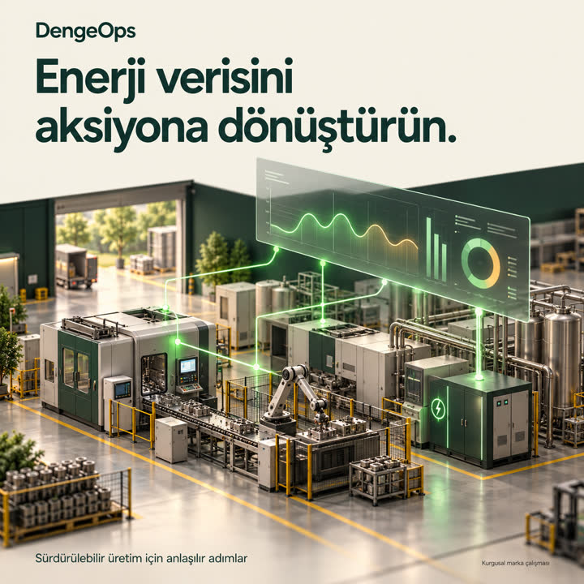
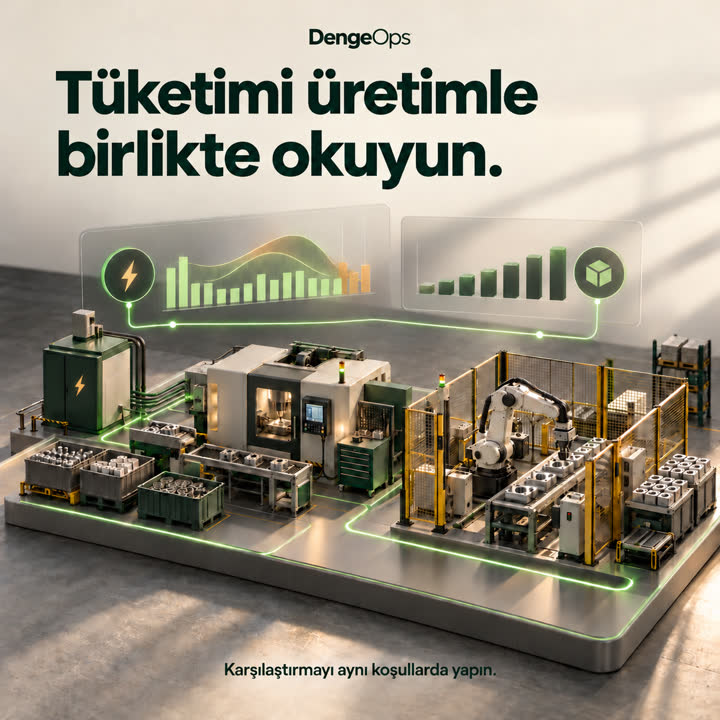
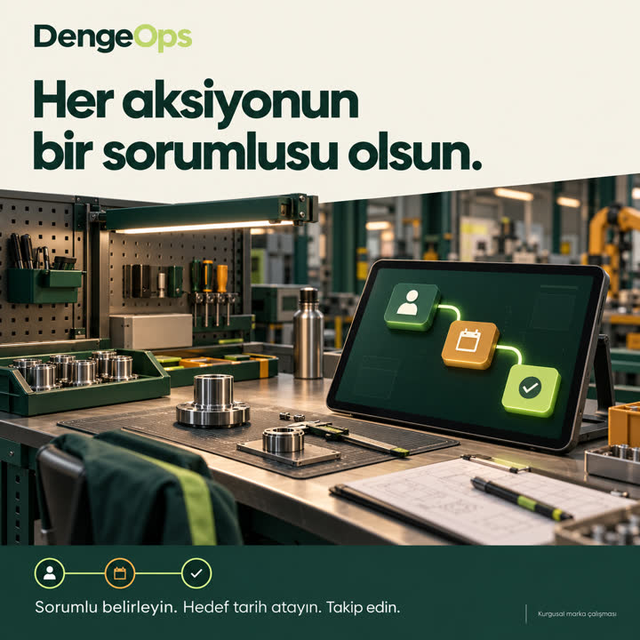

# DengeOps - Marka ve İçerik Çalışması

**Rana Beyza Culus · Endüstri Mühendisi**

Bu proje, Yapay Zekâ ile İçerik Üretimi eğitimi kapsamında hazırlanmıştır. DengeOps, üretim ekiplerinin enerji verisini yorumlama ve iyileştirme aksiyonlarını takip etme ihtiyacını konu alan kurgusal bir yazılım markasıdır.

## Canva sunumu

[Video ve ayrı ses kaydını içeren Canva sunumunu aç](https://www.canva.com/d/tqrPhqPk8LBek_k)

Canva sunumunda 10. slaytta sesli tanıtım videosu, 11. slaytta ayrı Türkçe ses kaydı bulunur. PDF sürümü statiktir; oynatılabilir video ve ses aşağıdaki dosyalardan veya Canva üzerinden açılır.

## Strateji ve plan

- [İki sayfalık marka stratejisi](./belgeler/DengeOps_Marka_Stratejisi.pdf)
- [Tek sayfalık marka sesi rehberi](./belgeler/DengeOps_Marka_Sesi_Rehberi.pdf)
- [Yedi günlük içerik takvimi (Excel)](./belgeler/DengeOps_Icerik_Takvimi.xlsx)
- [Blog, gönderiler ve seslendirme metni](./belgeler/DengeOps_Metinler.md)
- [Sunumun statik PDF sürümü](./belgeler/DengeOps_Profesyonel_Sunum.pdf)

## Video ve ses

- [18 saniyelik sesli tanıtım videosu (MP4)](./medya/DengeOps_Tanitim_18sn.mp4)
- [Ayrı Türkçe seslendirme (MP3)](./medya/DengeOps_Seslendirme.mp3)

## Yapay zekâ ile üretilen görseller

### Enerji verisini aksiyona dönüştürün

### Tüketimi üretimle birlikte okuyun

### Her aksiyonun bir sorumlusu olsun

## Kullanım ve şeffaflık

Marka ve ürün senaryosu eğitim projesi için kurgulanmıştır. Görseller yapay zekâ ile, Türkçe ses TTS ile üretilmiştir. Görsel panolar gerçek bir ürünün veya fabrikanın ekranı değildir. Tasarruf, müşteri, sertifika veya yayımlanmış kampanya başarısı iddiası içermez. Takvim önerilen yayın planıdır; içerikler yayımlanmamıştır. Kaynak ve içerik kontrol notları strateji belgesinde ve Canva sunumunda yer alır.
